# Game Collection and Achievement Tracker

A Steam-inspired DBMS college project for ABV-IIITM. It combines a Streamlit frontend with a MySQL backend for browsing games, maintaining player libraries and wishlists, recording purchases and play sessions, tracking achievements, publishing games, and administering the catalog.

## Main features

### Gamer

- Browse and search the game store.
- Purchase games and manage a library or wishlist.
- Start and finish gaming sessions.
- Track achievement progress.
- Write reviews and vote on helpful reviews.
- Update the player profile.

### Game publisher

- View publisher-specific game statistics.
- Add and update games owned by the publisher.
- Manage achievements for published games.
- View player reviews together with their game names.

### Admin

- View platform-wide metrics.
- Create gamer, publisher, and admin accounts.
- Create publishers and developers.
- Manage games and catalog data.
- Inspect purchases and moderate reviews.

## Technology

- Python 3.11+
- Streamlit 1.57+
- MySQL 8.0.16+
- `mysql-connector-python`
- bcrypt, pandas, Pillow, Plotly, and Requests

## Quick start on Windows

### Prerequisites

1. Install Python and MySQL Server 8.0.
2. Ensure the MySQL Server `bin` directory containing `mysqld.exe` is available on `PATH`.
3. Open a terminal in the project folder and install the dependencies:

```powershell
python -m pip install -r requirements.txt
```

### Start the complete application

Double-click `Start Game Collection.cmd`, or run:

```powershell
python run_demo.py
```

The launcher creates an isolated private MySQL instance inside `.demo-db`, initializes and seeds it on the first run, starts Streamlit, and opens the application in the default browser. Data added in the demo persists across restarts.

Keep the launcher terminal open while using the app. Press `Ctrl+C` in that terminal to stop both Streamlit and the private database.

### Demo accounts

| Role | Username | Password |
| --- | --- | --- |
| Gamer | `gamer1` | `Gamer@123` |
| Game publisher | `pub_valve` | `Publisher@123` |
| Admin | `admin` | `Admin@123` |

These are application demo credentials only. Private database passwords are generated locally and are never committed to Git.

## Entity-relationship diagram

The diagram below is generated from `schema.sql` and `sql/00_app_extension.sql`. `App_Account` is the login table used by the Streamlit application. `User_Account` remains part of the original base schema. `App_Lock` is an internal single-row table used to serialize administrative operations.

```mermaid
erDiagram
    USER ||--o| USER_ACCOUNT : has
    USER o|--o| APP_ACCOUNT : signs_in_with
    PUBLISHER o|--o{ APP_ACCOUNT : authorizes

    USER ||--o{ USER_GAME : owns
    GAME ||--o{ USER_GAME : appears_in
    USER ||--o{ PURCHASE : makes
    GAME ||--o{ PURCHASE : purchased_as

    GAME ||--o{ ACHIEVEMENT : defines
    USER_GAME ||--o{ USER_ACHIEVEMENT : earns
    ACHIEVEMENT ||--o{ USER_ACHIEVEMENT : unlocked_as
    USER_GAME ||--o{ GAMING_SESSION : records

    USER ||--o{ REVIEW : writes
    GAME ||--o{ REVIEW : receives
    REVIEW ||--o{ REVIEW_VOTE : receives
    USER ||--o{ REVIEW_VOTE : casts

    GAME ||--o{ GAME_DEVELOPER : developed_by
    DEVELOPER ||--o{ GAME_DEVELOPER : develops
    GAME ||--o{ GAME_PUBLISHER : published_by
    PUBLISHER ||--o{ GAME_PUBLISHER : publishes
    GAME ||--o{ GAME_GENRE : classified_as
    GENRE ||--o{ GAME_GENRE : groups
    GAME ||--o{ GAME_CATEGORY : tagged_as
    CATEGORY ||--o{ GAME_CATEGORY : groups
    GAME ||--o{ GAME_PLATFORM : supports
    PLATFORM ||--o{ GAME_PLATFORM : identifies

    USER {
        bigint user_id PK
        string username
        string profile_url
        int user_level
        datetime created_at
    }

    USER_ACCOUNT {
        bigint user_id PK, FK
        string email UK
        string password_hash
        datetime created_at
        datetime last_login_at
    }

    APP_ACCOUNT {
        bigint account_id PK
        string username UK
        string email UK
        string password_hash
        string role
        bigint user_id FK
        int publisher_id FK
        bool is_active
    }

    GAME {
        int appid PK
        string name
        date release_date
        bool is_free
        decimal price
        string currency
        string header_image_url
        bool is_active
    }

    DEVELOPER {
        int developer_id PK
        string developer_name UK
    }

    PUBLISHER {
        int publisher_id PK
        string publisher_name UK
    }

    GENRE {
        int genre_id PK
        string genre_name UK
    }

    CATEGORY {
        int category_id PK
        string category_name UK
    }

    PLATFORM {
        int platform_id PK
        string platform_name UK
    }

    GAME_DEVELOPER {
        int appid PK, FK
        int developer_id PK, FK
    }

    GAME_PUBLISHER {
        int appid PK, FK
        int publisher_id PK, FK
    }

    GAME_GENRE {
        int appid PK, FK
        int genre_id PK, FK
    }

    GAME_CATEGORY {
        int appid PK, FK
        int category_id PK, FK
    }

    GAME_PLATFORM {
        int appid PK, FK
        int platform_id PK, FK
    }

    USER_GAME {
        bigint user_id PK, FK
        int appid PK, FK
        string ownership_status
    }

    PURCHASE {
        bigint purchase_id PK
        bigint user_id FK
        int appid FK
        decimal price_paid
        string currency
        datetime purchased_at
    }

    ACHIEVEMENT {
        int achievement_id PK
        int appid FK
        string achievement_name
        int points
        bool hidden
    }

    USER_ACHIEVEMENT {
        bigint user_id PK, FK
        int achievement_id PK, FK
        int appid FK
        datetime unlock_time
    }

    REVIEW {
        int review_id PK
        bigint user_id FK
        int appid FK
        text review_text
        bool recommended
        datetime review_date
        int playtime_at_review
    }

    REVIEW_VOTE {
        int review_id PK, FK
        bigint user_id PK, FK
        bool is_helpful
        datetime voted_at
    }

    GAMING_SESSION {
        bigint session_id PK
        bigint user_id FK
        int appid FK
        datetime start_time
        datetime end_time
        int duration
    }

    APP_LOCK {
        int lock_id PK
    }
```



## Database setup in MySQL Workbench

For a manual database-only demonstration, use a fresh MySQL 8.0.16+ instance where the `game_tracker` database is absent. Execute these files in order:

1. `schema.sql`
2. `sample_data (1).sql`
3. `game_tracker_role_setup.sql`
4. `sql/00_app_extension.sql`

`queries.sql` contains repeatable example queries. The normal `run_demo.py` launcher performs the complete setup automatically.

## Tests

The test suite creates a temporary isolated MySQL instance and exercises database permissions, service logic, all role pages, forms, login behavior, and important constraints.

```powershell
python -m pytest -q
```

## Project structure

```text
app/                    Streamlit application and role pages
app/services/           Database service functions
sql/                    App extension, setup, and demo account scripts
tests/                  Isolated MySQL and Streamlit tests
schema.sql              Core normalized schema
sample_data (1).sql     Sample catalog and activity data
game_tracker_role_setup.sql
queries.sql             DBMS demonstration queries
run_demo.py             Complete local database and frontend launcher
Start Game Collection.cmd
```

## Security notes

- Passwords are stored as bcrypt hashes.
- SQL calls use parameterized values or stored procedures.
- Gamer, publisher, and admin database accounts have separate privileges.
- Publishers are limited to their own games through stored procedures.
- `.env`, `.demo-db`, generated credentials, logs, caches, and downloaded poster files are excluded from Git.
